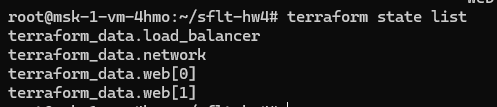
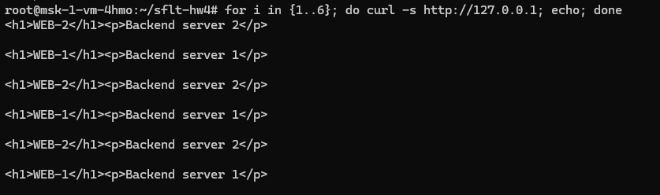
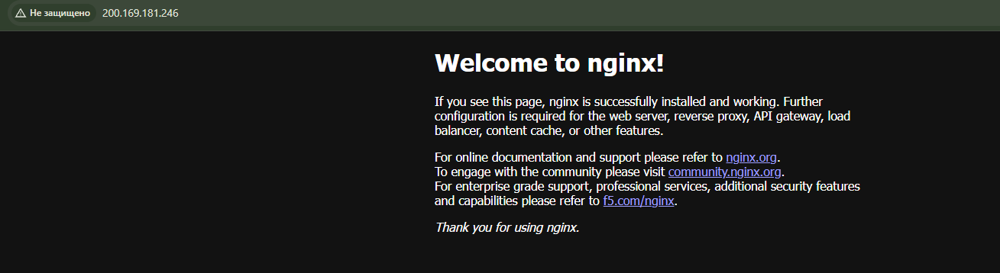

# Домашнее задание к занятию «Отказоустойчивость в облаке»

**Выполнил:** Захар Полев

## Задание 1

В связи с временной недоступностью Yandex Cloud инфраструктура была развернута на виртуальной машине Ubuntu 24.04 в Timeweb Cloud.

В качестве аналога двух виртуальных машин используются два изолированных Nginx-контейнера, создаваемых Terraform с помощью `count = 2`.

В качестве сетевого балансировщика используется HAProxy.

Схема инфраструктуры:

```text
Internet
   |
   v
200.169.181.246:80
   |
   v
HAProxy
   |
   +--- web-1:80
   |
   +--- web-2:80
```

HAProxy выполняет балансировку запросов между двумя backend-серверами и HTTP healthcheck на порту 80.

### Terraform Playbook

[main.tf](./main.tf)

### Конфигурация HAProxy

[haproxy.cfg](./haproxy.cfg)

### Terraform state

Terraform создает два одинаковых backend-экземпляра:

```text
terraform_data.web[0]
terraform_data.web[1]
```



### Статус балансировщика и backend-серверов

Оба backend-сервера находятся в состоянии `UP`.

HTTP healthcheck возвращает `L7OK/200`.



### Проверка внешнего IP балансировщика

Страница Nginx доступна через внешний IP балансировщика:

```text
http://200.169.181.246
```



### Проверка балансировки

Последовательные запросы распределяются между двумя backend-серверами:

```text
WEB-1
WEB-2
WEB-1
WEB-2
WEB-1
WEB-2
```


